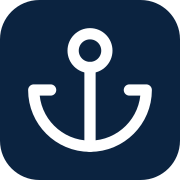
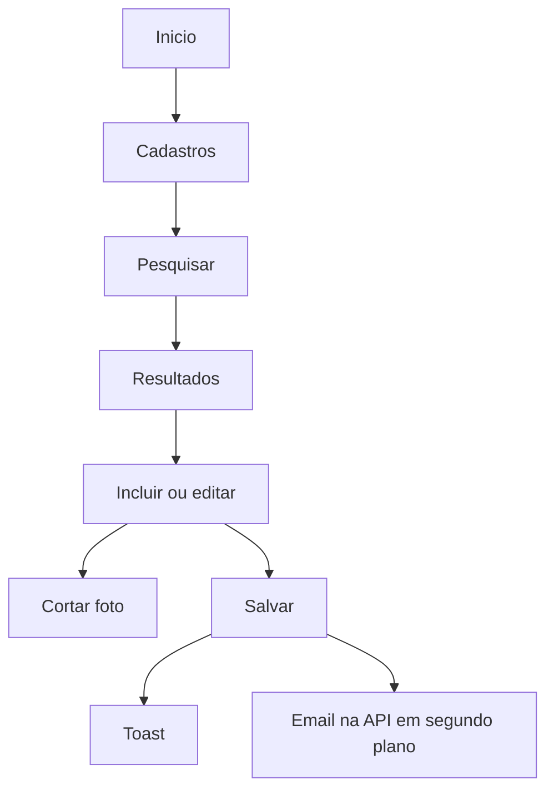

<p align="center">
  
</p>

<h1 align="center">Cadus Frontend</h1>

<p align="center">
  Interface do <strong>cadastro de pessoas</strong> da operação portuária<br />
  Next.js, HeroUI, Bun e API Cadus
</p>

<p align="center">
  
  
  
  <br />
  
  
  
  <br />
  
  
  
</p>

---

## Links

<p align="center">
  <a href="https://github.com/dvizioon/VIZIOON-CADUS-FRONTEND">
    
  </a>
  &nbsp;
  <a href="http://localhost:3000">
    
  </a>
</p>

- Repositório: [github.com/dvizioon/VIZIOON-CADUS-FRONTEND](https://github.com/dvizioon/VIZIOON-CADUS-FRONTEND)
- App local: [http://localhost:3000](http://localhost:3000)
- Cadastro de pessoas: [http://localhost:3000/cadastros/pessoas](http://localhost:3000/cadastros/pessoas)
- API local: [http://localhost:8080](http://localhost:8080)

---

## Funcionalidades

- **Cadastro de pessoas:** CPF, nome, cargo, salário, contrato, contato, endereço, foto e anexos PDF.
- **Pesquisa:** filtros por CPF, nome, faixa salarial e período de contrato.
- **Tabela:** miniatura da foto, máscaras de CPF e salário, situação, editar, excluir, reenviar e-mail e ativar/desativar.
- **Foto:** recorte no modal (1:1 padrão, 4:3, 3:4, 16:9), saída até 512 px, clique abre a imagem no Fancybox.
- **Contrato indeterminado:** checkbox; data fim fica opcional.
- **CEP:** consulta ViaCEP com fallback na República Virtual.
- **Cargos:** select pesquisável com a lista da API.
- **E-mail:** toast no salvar; confirmação segue em segundo plano na API.
- **PDF:** upload e visualização em iframe (RG, CPF e comprovante de residência).
- **Acessibilidade:** linha do tempo das seções, labels e navegação por teclado nos campos HeroUI.
- **Layout:** sidebar com GSAP, Início, Cadastros, Contratos e Relatórios (os dois últimos ainda em construção).

## Tecnologias utilizadas

- **Next.js 16** (App Router) e **React 19**
- **HeroUI v3** só via `@/shared/ui` (Tailwind CSS v4)
- **Bun** para install, dev e testes
- **Zod + React Hook Form** no formulário
- **TanStack Query** para API
- **GSAP** na abertura da sidebar
- **react-easy-crop** e **@fancyapps/ui** na foto
- **Iconify** (Lucide) nos ícones, inclusive a âncora do menu

## Plataformas

| Superfície | Status |
|------------|--------|
| Navegador (Chrome, Edge, Firefox) | Compatível |
| App local `localhost:3000` | Compatível |
| API Cadus `localhost:8080` | Obrigatória para salvar |
| Contratos | Em construção |
| Relatórios | Em construção |

## Fluxo da tela



## Estrutura do projeto

```bash
frontend/
│
├── src/
│   ├── app/                      # Rotas Next (inicio, cadastros, contratos, relatorios)
│   ├── features/people/          # Página, form, tabela, API, Zod
│   ├── shared/
│   │   ├── layout/               # Shell, sidebar, navbar
│   │   ├── ui/                   # Wrappers HeroUI
│   │   ├── utils/                # Máscaras, crop, PDF
│   │   └── lib/                  # HTTP e cn
│   └── app/globals.css
│
├── docs/ancora.svg
├── .env.example
├── bun.lock
├── next.config.ts
├── package.json
└── README.md
```

## Instalação

### Desenvolvimento local

1. **API:** o backend Cadus precisa estar em `http://localhost:8080`.

2. **Clone:**

   ```bash
   git clone https://github.com/dvizioon/VIZIOON-CADUS-FRONTEND
   cd VIZIOON-CADUS-FRONTEND
   ```

3. **Ambiente (opcional):**

   ```bash
   cp .env.example .env
   ```

4. **Instale e rode:**

   ```bash
   bun install
   bun run dev
   ```

   Abre em [http://localhost:3000](http://localhost:3000).

5. **Qualidade:**

   ```bash
   bun run test
   bun run typecheck
   bun run lint
   ```

6. **Build:**

   ```bash
   bun run build
   bun run start
   ```

## Variáveis de ambiente (`.env`)

| Variável | Padrão | Descrição |
|----------|--------|-----------|
| `NEXT_PUBLIC_API_URL` | `http://localhost:8080` | Base da API Cadus |

## Scripts

| Comando | Descrição |
|---------|-----------|
| `bun run dev` | Servidor de desenvolvimento |
| `bun run build` | Build de produção |
| `bun run start` | Sobe o build |
| `bun run test` | Testes (Bun) |
| `bun run typecheck` | TypeScript |
| `bun run lint` | ESLint |

## Contato

Dúvidas: [danielmartinsjob@gmail.com](mailto:danielmartinsjob@gmail.com)

**Cadus:** cadastro de pessoas da gestão portuária. Desafio Evereste.
